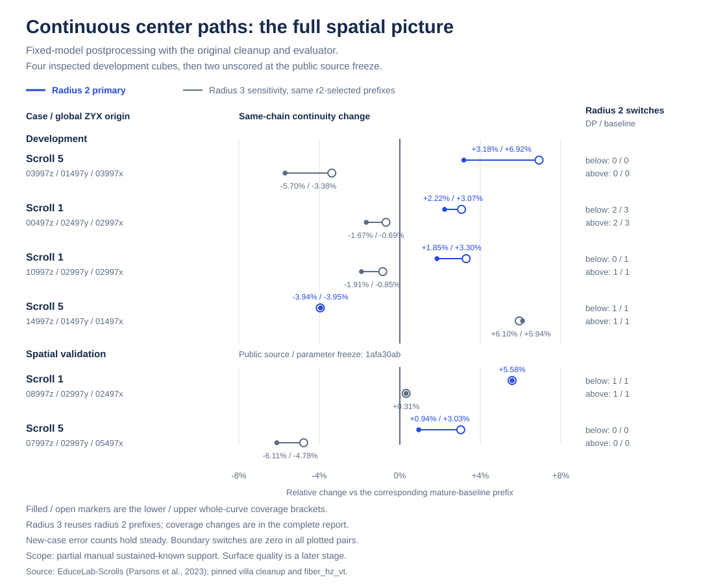

# Fiber Continuity

**Check whether traced lines stay on the same papyrus fibers.** Import a native AFV
file and hand-labelled fibers for the same crop; measure how much reference fiber
is found, how far each line stays on one fiber, and jumps to neighbouring fibers.
The native adapters retain original IDs, coordinate frames and declared gaps.

## In plain English

On the two preregistered test cubes with the same fixed prediction model:

- **Find more fiber overall:** current AFV's raw output covers more of the labelled fibers.
- **Compare continuous chains:** after matching roughly the same reference-fiber coverage,
  the older spline/gap tracer with native cleanup keeps more of it in unbroken same-fiber chains.
- **Extra DP step:** the trace-adjustment add-on failed its improvement test against
  that older cleaned baseline on both new cubes, so its default upgrade is stopped.

The useful handoff is the AFV/manual-fiber checker and native export. The measurements
and complete positive/negative research history follow below.

## Prospective spatial validation — simpler matched-coverage operating point

**Use the original legacy spline/gap-MLP pipeline with native cleanup for
matched-coverage long chains in these two prospective ROIs. Use current raw
AFV for full-output coverage and absolute continuity. Fixed DP default upgrade
stops.** The publicly preregistered
whole-pipeline comparison uses a new s1 native 256 cube and a fixed centre
crop of an s5 native 512 cube. Primary (DP-clean/current raw), companion
(DP-clean/current clean) and DP-specific (DP-clean/legacy baseline) gates
are independent.

Radius-2 relative continuity changes at the frozen lower / upper whole-curve brackets:

| ROI | Legacy-clean / current raw | DP-clean / current raw | DP-clean / current clean | DP-clean / legacy-clean |
|---|---:|---:|---:|---:|
| s1 | +1.65282% / +0.17769% | +1.00588% / -0.74768% | +3.01208% / +1.18880% | -2.20645% / -1.32129% |
| s5 | +6.42627% / +6.06660% | +4.10436% / +2.81256% | +3.86900% / +2.58300% | -2.71637% / -2.71637% |

Both legacy-baseline architecture gates pass. DP-clean's primary gate fails
at the s1 upper bracket **−0.74768%**; the equally-cleaned companion passes.
The DP-specific gate fails in both cases, with all four radius-2 brackets
negative; its s1 radius-3 changes are **−3.60780% / −2.24525%**. All **21,977**
legacy-clean segments and **35,799** segments in two new current-raw positive
controls pass the unchanged native family validator, preserving original gaps.
The fixed checkpoint declares an **18-item labeled dataset pool** and fold **0**.
The [fixed-model source registry](research/fixed-model-training-provenance.json)
records all eight evaluated ROI source names in the dated public HZVT corpora;
the original augmented-item and fold-0 train/validation manifests provide the
remaining per-case model exposure record. Prospective scope is postprocessor/comparator
parameter holdout and first reference performance in the two declared ROIs.

[Full prospective report](research/whole-pipeline-spatial-validation.md) ·
[All 40 matched / 16 full aggregate rows](research/whole-pipeline-spatial-results.json) ·
[Immutable preregistration](https://raw.githubusercontent.com/blucca/fiber-continuity/bd4aac2b230094a898db52b8f1cbf12e9a6799e8/research/whole-pipeline-spatial-freeze.json).
Fixed-model training membership and the new postprocessor parameter holdout
are recorded separately. The earlier comparisons below retain their own
source, comparator and time windows.

## Archived center-path method

The dynamic program jointly selects transverse positions along each existing fiber. It preserves topology, source IDs, endpoints and gap provenance, then uses the original native cleanup. A same-station pointwise control isolates the path-selection change.

## Earlier revealed two-case whole-pipeline benchmark

**Choose the operating point for the downstream task.** The
[complete legacy pipeline + fixed DP + native cleanup](research/whole-pipeline-comparison.md)
provides longer same-chain arcs at matched manual coverage on two previously
scored cubes. The current author's raw AFV provides greater full-output coverage
and greater absolute full-output continuity in both cubes.

| Scroll | Whole-pipeline radius-2 continuity gain vs current raw, lower / upper | Observed interior switches, legacy DP / current raw |
|---|---:|---:|
| s1 | **+21.961% / +19.547%** | 1 / 2 |
| s5 | **+8.229% / +6.868%** | 0 / 1 |

Both current-raw and equally native-cleaned comparator gates pass; the legacy
pipeline without DP also passes. All **18,502** segments in the four legacy
native-clean outputs satisfy the current author's assigned-family validator,
with every original gap preserved. This is a two-revealed-cube benchmark.
The DP-specific fresh validation against the legacy pipeline appears below.
[All 32 matched / 16 full rows, architecture control and native audit](research/whole-pipeline-results.json).

### Direct transfer onto the current emitter

The [current author's medial-ridge AFV defaults](research/current-medial-ridge-transfer.md)
win the fixed-DP transfer comparison on both already-inspected cubes using the
existing `fiber_hz_vt` input. Keep the author's original geometry at this
operating point:

| Scroll | Raw matched-radius-2 continuity change, lower / upper | Same native cleanup, lower / upper |
|---|---:|---:|
| s1 | −2.110% / −2.145% | +1.676% / −0.222% |
| s5 | −10.692% / −10.729% | −7.700% / −8.518% |

s1 radius-3 observed interior switches increase from 6 to 10. The author's
unchanged native family validator passes all 27,031 original segments; fixed
DP violates that contract in 17 segments. Default migration to this current
emitter stops. [All full/matched rows and native audit](research/current-medial-ridge-results.json).
The recommended V2 model is a separate, untested input in this study.

### Earlier source-pinned spline-pipeline validation

After an [immutable source/parameter freeze](https://github.com/blucca/fiber-continuity/tree/1afa30ab840f7606f0b6594213731c5a88202c61), two fresh spatial parameter-heldout cubes pass the published native-clean radius 2 gate:

| Scroll / cube | Matched-lower same-chain continuity gain | Observed interior switches DP / baseline |
|---|---:|---:|
| s1 / `08997_02997_02497` | **+5.581%** | 1 / 1 |
| s5 / `07997_02997_05497` | **+0.939%** | 0 / 0 |

Upper-bracket gains are +5.581% / +3.029%. Boundary switches are 0 in both methods. Radius 3 sensitivity increases in s1 and decreases in s5. The preceding four development cubes include three positive and one negative radius 2 result.

[](research/centre-path-comparison.svg)

Regenerate this figure from the published aggregates: `python research/plot-centre-path-comparison.py`.

- [Complete fresh validation: full/matched, raw/clean, both radii, controls](research/continuous-path-spatial-validation.md).
- [Method, fixed parameters and executable CT/P/traces command](research/continuous-centre-path-study.md).
- [Annotation-aware evaluator](contract.md): coverage, sustained tree-ID switches, same-chain continuity, unknown and ambiguous arcs are separate measurements. Original nodes, edges and branches stay intact.

The measured scope is fixed-model centering after native cleanup on partial manual references. Whole-volume deployment and surface-quality stages follow their own downstream measurements.

## Read an author's native AFV

[`afv_to_traces.py`](afv_to_traces.py) reads the measured binary64 SQLite AFV
schema, retaining IDs, family, point order, one shared block endpoint and
metadata. All points in the two author-generated archives match exactly.

```bash
python afv_to_traces.py --afv data/default.afv --case same-ROI \
  --origin-xyz 0 0 0 --output data/default-traces.json
python evaluate.py --reference data/reference.json --traces data/default-traces.json \
  --case same-ROI --radius 2 --output results/default-r2.json
```

ROI-local AFV uses zero origin; full-volume AFV uses the NML ROI's global XYZ
origin. The importer reads the supplied archive into memory, so use ROI-sized
archives for these comparisons. `check.py --examples temp/synthetic` also
checks a hand-built 601-point, three-block AFV fixture.

[`match_coverage.py`](match_coverage.py) compares two same-frame trace outputs
using fixed radius-2 longest-first whole-curve lower/upper brackets, then
reuses the exact prefixes at radius 3. It includes all full/matched metrics
and selected curves. [Complete current-comparator commands](research/current-medial-ridge-transfer.md#repeat-the-fixed-comparison).

## Native typed object handoff

[`native_v4_store`](native/README.md) bridges ROI-local trace envelopes through native V4 polyline JSON into a checked `.vcobj`, closes/read-only reopens it, and verifies immutable typed fiber loads and volume-frame identity. The pinned native library passed the all-synthetic fixture and real trace archives, including the fresh s1 baseline (78 curves) and DP (79 curves). [Aggregate fresh native check](native/heldout-check.json). The small C++ CLI uses the existing native targets with the Python/server stack disabled.

## Run in minutes

Python 3.10+ and NumPy:

```bash
git clone https://github.com/blucca/fiber-continuity.git
cd fiber-continuity
python -m pip install numpy
python check.py --examples temp/synthetic
python evaluate.py --reference temp/synthetic/reference.json \
  --traces temp/synthetic/traces.json --output temp/synthetic/metrics-r2.json
```

Six executable synthetic checks cover original-edge/degree-3 identity,
sustained switches with ROI-boundary separation, unknown/ambiguous support,
XYZ/global-origin handling, full coverage with fragmented continuity, and
matched-coverage brackets with identical radius-3 prefixes.
The example NML and JSON are hand-authored synthetic geometry.

## Use original manual fibers

Download the official [fiber-skeletons ZIP](https://dl.ash2txt.org/datasets/fiber-skeletons/fiber-skeletons.zip)
from the [Vesuvius data server](https://dl.ash2txt.org/datasets/fiber-skeletons/).
Original manual skeletons live in
`fiber-skeletons/Dataset001_sk-fibers-20250124/nml/`; `imagesTr/` contains CT cubes
and `labelsTr/` contains voxelized labels. The evaluator consumes manual graph
geometry and predicted polylines. CT and binary labels are separate inputs for
the research methods that generate those polylines.

For the development cube, extract
`fibers_s5_03997z_01497y_03997x_256_v00.nml` into your local `data/` directory.
Its Full Cube origin is global XYZ `[3997,1497,3997]`, side length 256 voxels.

```bash
python nml_to_reference.py \
  --nml data/fibers_s5_03997z_01497y_03997x_256_v00.nml \
  --origin-xyz 3997 1497 3997 --size 256 --output data/s5/reference.json

# Supply your method's connected polylines in the same ROI-local XYZ frame.
python evaluate.py --reference data/s5/reference.json --traces data/s5/traces.json \
  --case s5_03997_01497_03997_256 --radius 2 --output results/s5-r2.json
# Fixed sensitivity analysis: change the radius and output filename together.
python evaluate.py --reference data/s5/reference.json --traces data/s5/traces.json \
  --case s5_03997_01497_03997_256 --radius 3 --output results/s5-r3.json
```

The converter uses Python's standard library. It preserves global and local XYZ,
original graph identity and node attributes, NML parameters including Full Cube,
and the original 7.91 µm scale. `--origin-xyz X Y Z` and `--size N` declare a cubic
ROI in NML voxel coordinates. Array axes are ZYX. For global XYZ predictions,
add `--prediction-coordinates global-xyz`; the evaluator subtracts the ROI origin.

The original s5 and s1 NMLs were checked against the existing reference schemas:
all original nodes, edges, coordinates, inside flags, Full Cube metadata and
7.91 µm spacing agreed; original-edge partitions and ROI arc lengths agreed.
These checks use geometry integrity, separate from prediction measurements.

Trace JSON accepts a list of curves or an envelope with a `curves` list:

```json
[{"id":"synthetic-trace","family":"V","points_xyz":[[8,10,12],[48,10,12]]}]
```

Each unique `id` identifies one connected polyline; every consecutive pair of
points is an actual connection. Family labels are descriptive. JSON envelopes
can carry `case`, `shape_zyx`, `coordinates` and provenance. NPZ supports
`points_xyz` (M×3), `offsets` (K+1), and optional `chain_ids`/`family` string arrays.
See [contract.md](contract.md) for the metric and input contract.

## Real aggregate baseline: s5, threshold 60

Development case: `s5_03997_01497_03997_256`, 256³ voxels at 7.91 µm.
The manual ROI arc denominator is **15,654.564 vox**: 14,809.710 fully-inside
original-edge vox plus 844.854 clipped boundary-intersecting vox.
The visible-reference same-chain ceiling is **0.9674907193**.
Fractions below are rounded to six decimals; arc lengths to three.

| Radius (vox) | Stage | Manual coverage | Same-chain continuity | / visible ceiling | Interior / boundary switches | Sustained support (vox) | Eligible chains | Unknown arc (vox) |
|---:|---|---:|---:|---:|---:|---:|---:|---:|
| 2 primary | extracted | 0.380268 | 0.192546 | 0.199016 | 0 / 0 | 5393.002 | 96 | 12870.523 |
| 2 primary | default clean | 0.266024 | 0.153735 | 0.158901 | 0 / 0 | 3860.528 | 44 | 6576.140 |
| 2 primary | MLP extended-clean | 0.278677 | 0.160557 | 0.165952 | 0 / 0 | 4041.766 | 44 | 6958.827 |
| 3 sensitivity | extracted | 0.564298 | 0.326525 | 0.337497 | 0 / 0 | 8217.350 | 118 | 10233.534 |
| 3 sensitivity | default clean | 0.403545 | 0.264547 | 0.273436 | 0 / 0 | 6035.694 | 50 | 4534.681 |
| 3 sensitivity | MLP extended-clean | 0.418161 | 0.276466 | 0.285756 | 0 / 0 | 6257.501 | 50 | 4887.625 |

Stage keys are `extracted`, `clean-default`, `extended-clean-default`.
Ambiguous-between-trees arc is 0 vox in all six rows. Eligible chains contain at
least one contiguous known-tree support run of ≥8 vox. The zero observed
switches describe those supported arcs; unknown/unannotated arcs retain their
separate totals. Compare methods at matched manual coverage, then compare
interior switches and same-chain continuity. The [research note](research/centerline-preservation.md) adds the first fixed
development probe; matched-coverage and frozen-tracer validation are the next checkpoints.

**Baseline provenance.** The mature spline/catalog/MLP extension/cleanup method
is [ScrollPrize/villa@c3d9da6fe42c3bb46fd2603ca060845d843296c3](https://github.com/ScrollPrize/villa/tree/c3d9da6fe42c3bb46fd2603ca060845d843296c3),
documented in its [fiber spline generator](https://github.com/ScrollPrize/villa/blob/c3d9da6fe42c3bb46fd2603ca060845d843296c3/vesuvius/docs/fiber_spline_generator.md).
These measurements use the fixed segmentation model
[`scrollprize/fiber_hz_vt@0905e68f14b33d1b98fd32d726f2c97607dea80c`](https://huggingface.co/scrollprize/fiber_hz_vt/tree/0905e68f14b33d1b98fd32d726f2c97607dea80c).
The upstream CLI default model is `Qualzz20/afv_fiber_9um`; its identity is
distinct from the model measured here. The optional gap MLP uses the upstream
`gap_model.pt` SHA-256 `6585182d2c4f609cc97941685f4a34d74918bdc5a4e18d3d9b69dcda6643f234`.

The completed run used T4 FP16 fixed-model inference, then native-format uint8
V/H/intersection probabilities shared across stages. Pinned upstream spline,
catalog, extension and cleanup logic ran with SciPy/scikit-image CPU primitives
and a checked FP32 NumPy gap scorer (native fixture max error 2.142×10⁻⁸).
The ROI was a single 256³ block with zero outside margin; boundary observations
are reported separately. Default cleanup used 45° joins, 100-vox minimum length
and 16-vox exterior-black distance. Prediction inputs were CT and fixed model
probabilities; manual annotations supplied the evaluation reference.

s1 (`s1_00497_02497_02997_256`) connectivity and coverage are now **inspected**
through the first postprocessor parameter holdout, after the immutable
[`f88e889` method freeze](https://github.com/blucca/fiber-continuity/tree/f88e8894fa7dad1a56f670796f893a6793618faa).
Parameter tuning on s1: 0. At radius 2, CT-primary clean matched-below continuity
is **0.239840** versus **0.230280** (+4.15%), with coverage 0.403873 versus
0.404060 and observed interior switches 3 versus 3. Two event pairs persist;
one baseline-only and one CT-only pair change the composition. Raw deployment
is stopped: r2 observed switches 4 versus 3, r3 6 versus 4. Radius 3 matched-clean
coverage and continuity decrease; full, matched, unknown and ambiguous totals
are in the [complete study](research/bounded-logit-study.md#first-s1-postprocessor-parameter-holdout).
The pretrained model's declared 18-item labeled pool and original augmented-item/
fold-0 membership are recorded in the [source registry](research/fixed-model-training-provenance.json);
the heldout protocol concerns the postprocessor parameters.
Historical research notes retain their publication snapshots. Native VC3D UI replay
is a separate protocol; its execution count here is 0.

## Version, data license and attribution

`evaluate.py` is the byte-for-byte measured v1 source:
SHA-256 `e46cb2dd5579231fefe8b33fd4173393496fdc10ad29e6525b7de39d06fbb010`.
The main branch publishes this evaluator, its NML converter, synthetic checks
and the aggregate baseline above. Model inference and CT intake use the linked
upstream research tools. The standalone repository is the early public
artifact; the upstream human-written PR route remains stopped.

Predictor input reproduction: [FP32 four-channel export](research/float-input-reproduction.md).

Code and synthetic examples: [MIT](LICENSE). Data: the
[Vesuvius Challenge Data License](https://dl.ash2txt.org/LICENSE.txt), which
requires written approval for raw-data redistribution. This repository ships
source, hand-authored synthetic examples and aggregate statistics. Obtain raw
CT, labels and NML from the official server and keep their geometry/derived
references in local data directories.

Data from EduceLab-Scrolls are acknowledged through:

Parsons, S., Parker, C. S., Chapman, C., Hayashida, M., & Seales, W. B. (2023).
*EduceLab-Scrolls: Verifiable Recovery of Text from Herculaneum Papyri using
X-ray CT.* [arXiv:2304.02084](https://arxiv.org/abs/2304.02084).
[doi:10.48550/arXiv.2304.02084](https://doi.org/10.48550/arXiv.2304.02084).

Research code authored by Codex; repository maintained by blucca. Manual fiber
annotations and upstream models/methods are credited to their original authors.

### Earlier method archive

[Ownership safety study and validation freeze](research/ownership-safety-study.md): the unchanged CT method was frozen as primary for two extra spatial cubes. A complete persistent-marker guard produced 0 fallbacks on the two revealed development cubes and is retained as a negative control. [The complete results](research/four-cube-validation.md) record radius2 matched-continuity failures on both new spatial cubes. Native typed object handoff has passed independently.

Earlier method snapshots: [short-junction probe](research/centerline-preservation.md), [incoming direction / reverse-flow](research/incoming-direction-study.md), [bounded-logit centering](research/bounded-logit-study.md), [overlap ownership / native augmentation](research/overlap-ownership-study.md). The earlier Gaussian method retains its two extra-cube failures; default upgrade promotion for that method is stopped.
