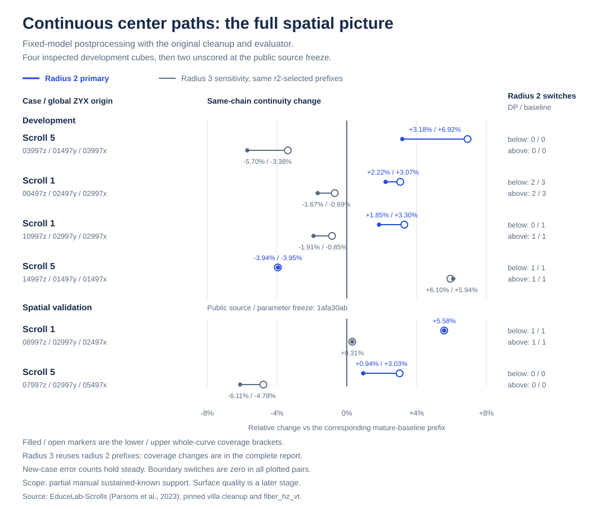

# First continuous-path spatial validation

Source-pinned spline/gap-pipeline result below. The later
[current medial-ridge AFV transfer](current-medial-ridge-transfer.md) retains
the same DP and fixed-model input and fails both current-emitter default
gates; its complete raw/clean and native family-contract results are separate.

**Both newly held-out cubes pass the published native-clean radius2 gate:** common-coverage lower-bracket continuity improves **5.581%** in s1 and **0.939%** in s5, with observed interior/boundary switch counts unchanged. Upper-bracket gains are 5.581% and 3.029%. Radius3 clean sensitivity increases in s1 and decreases in s5.

The figure uses the two published aggregate snapshots. [Regenerate it with the standard-library renderer](plot-centre-path-comparison.py).

## Frozen scope

Immutable source/parameter freeze: [`1afa30ab840f7606f0b6594213731c5a88202c61`](https://github.com/blucca/fiber-continuity/tree/1afa30ab840f7606f0b6594213731c5a88202c61). All four algorithm source files, the evaluator and the manifest were anonymously fetched and byte-matched at 2026-11-10 01:39:42 UTC. New case reference-performance and image reads at that point: 0. The first run completed both CT/P-only geometry and native-cleanup cases before opening either reference. Postprocessor heldout tuning: 0.

Cases were selected by official file names. The fixed `scrollprize/fiber_hz_vt` segmentation model and original manual NML graphs are the same pinned assets documented in [README](../README.md). The validation scope covers the postprocessor parameters; pretrained model training membership is recorded separately. Both cases are now inspected and serve as development data for later methods.

## Radius2 common-coverage comparison

Whole curves are sorted longest-first. The richer output is reduced to lower/upper brackets around the poorer output's manual coverage. Both brackets are retained, and radius3 evaluates the exact same prefixes.

| Case | Stage | Bracket | Reduced output/count | Coverage DP / baseline | Same-chain continuity DP / baseline | Interior/boundary switches DP / baseline |
|---|---|---|---|---:|---:|---|
| s1_08997_02997_02497_256 | raw | below | dp 275 | 0.508159 / 0.508736 | 0.211900 / 0.201288 (+5.272%) | 1/0 / 1/0 |
| s1_08997_02997_02497_256 | raw | above | dp 276 | 0.508768 / 0.508736 | 0.211900 / 0.201288 (+5.272%) | 1/0 / 1/0 |
| s1_08997_02997_02497_256 | clean | below | dp 76 | 0.372138 / 0.372943 | 0.170534 / 0.161520 (+5.581%) | 1/0 / 1/0 |
| s1_08997_02997_02497_256 | clean | above | dp 77 | 0.375918 / 0.372943 | 0.170534 / 0.161520 (+5.581%) | 1/0 / 1/0 |
| s5_07997_02997_05497_256 | raw | below | dp 145 | 0.489729 / 0.490504 | 0.239244 / 0.230794 (+3.661%) | 0/0 / 0/0 |
| s5_07997_02997_05497_256 | raw | above | dp 146 | 0.490930 / 0.490504 | 0.239244 / 0.230794 (+3.661%) | 0/0 / 0/0 |
| s5_07997_02997_05497_256 | clean | below | dp 64 | 0.390689 / 0.392391 | 0.209920 / 0.207966 (+0.939%) | 0/0 / 0/0 |
| s5_07997_02997_05497_256 | clean | above | dp 65 | 0.395208 / 0.392391 | 0.214265 / 0.207966 (+3.029%) | 0/0 / 0/0 |

## Radius3 sensitivity and causal control

Native-clean s1 lower/upper radius3 continuity is +0.313%/+0.313%, with coverage differences −1.4550/−1.0129 percentage points and interior switches 2 versus 2. Native-clean s5 continuity is −6.111%/−4.779%, with coverage differences −1.4144/−0.8646pp and interior switches 1 versus 1. Raw radius3 continuity is −0.561% in s1 and −2.830% in s5; raw interior switches are 3 versus 3 and 1 versus 1. Boundary switches remain 0 in all rows.

The same-station pointwise control changes only path selection. Full-clean radius2 DP versus pointwise has coverage −0.1121pp/−0.3499pp and relative continuity +0.467%/+4.809% for s1/s5. Full-clean radius3 relative continuity is −0.827%/+2.428%. Control comparisons use full outputs; the common-coverage primary comparison is DP versus the mature baseline.

[All 24 full and 16 matched aggregate rows](centre-path-heldout-results.json) include sustained support, unknown/ambiguous arc, eligible chains, exact counts and coverage differences. Observed switch counts refer to sustained known-tree support in the partial original annotations. Error-count reduction in these two fresh cases: 0. The preceding four development cases retain their three-positive/one-negative radius2 results in the [method study](continuous-centre-path-study.md).

## Native handoff and delivery scope

The fixed operator preserves the mature topology, knots, gaps and source IDs. It is executable through `research/run_centre_path.py`; the upstream native cleanup parameters remain 45°/100 vox/16 vox black distance. The repository also provides the [native V4→typed ObjectStore CLI](../native/README.md). On the fresh s1 cube it actually writes and read-only reopens the baseline (78 curves, 4,379 points) and fixed DP (79 curves, 5,168 points), then loads every immutable FiberView. Source IDs, point order, controls, gaps and global XYZ stay intact; the original float32 ObjectFrame roundtrip error is at most 0.00048828125 voxel. The ROI origin is applied once and the frame binds to the real `metadata.json` volume.id. [Complete aggregate native check](../native/heldout-check.json). Full surface fitting consumes a same-frame real base/UV mappings or umbilicus/orientation and the corresponding native loss inputs. Those surface-quality stages retain their own measurements.

The current measured capability is bounded fixed-model centering plus native-clean radius2 continuity. Whole-volume deployment promotion and surface-quality claims follow their real downstream measurements.
