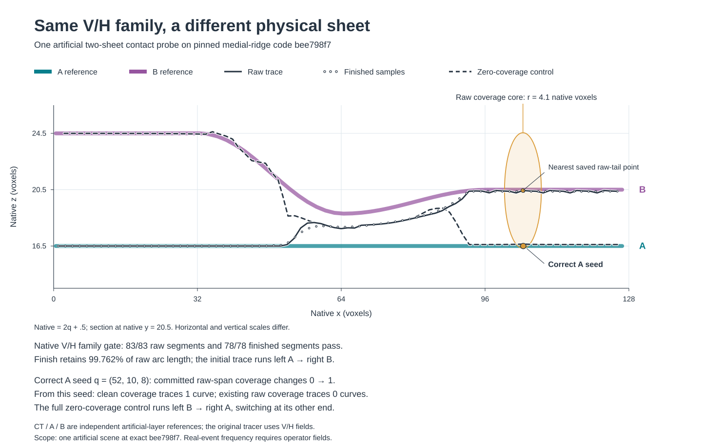

# A long trace can hide a seed on the right sheet

Two nearby sheets can contain fibers from the same family. The tracer checks
that a line follows V rather than H, then marks nearby parallel paths as covered.
This fixed artificial example runs the real tracer: a long line starts on sheet A,
continues on B, and its coverage causes a separate A-layer seed to be skipped.



## The complete measured result

Source: **Qualzz/AVF_SPLINE_GENERATOR at
`bee798f72751169065fe020d4ad02c52519c2d2b`**. The artificial V/H fields pass through
its original pooling, axes, centrality, seed generation, tracing, coverage and
finish functions. The two selected seeds both come from its prepared primary
seed catalog. The native and pooled family checks examine every adjacent segment.

| Output | Whole curves | Points / segments | Whole arc, native voxels | Family-invalid segments |
| --- | ---: | ---: | ---: | ---: |
| First A seed, raw | 1 | 84 / 83 | 125.034532 | 0 |
| Original finish | 1 | 79 / 78 | 124.737010 | 0 |
| A-tail seed, zero coverage | 1 | 84 / 83 | 125.621871 | 0 |
| Same seed, first raw coverage | 0 | 0 / 0 | 0 | 0 |

The first trace starts at native **(1, 20.5, 16.5)** on A and ends at
**(125.434593, 20.5, 20.386551)** on B. Finish retains one whole curve and
**99.762049%** of its raw arc. In the separated right-hand region, tracing
`x ≥ 48`, both raw and finished paths stay on B for over 28 native voxels.
The artificial sheet centers there are native `z = 16.5` and `z = 20.5`.

The prepared A-layer seed is tracing **(52, 10, 8)**, native
**(104.5, 20.5, 16.5)**. Its original presence is 140, centrality 14949 and
axis (1, 0, 0). After the first raw span commits its coverage:

| State | Coverage count | Same-direction covered | Trace from this seed |
| --- | ---: | --- | --- |
| Before | 0 | false | 1 whole curve |
| After | 1 | true | 0 curves |

**The full zero-coverage control also changes sheets at its other end.**
It runs from B on the left to A on the right; its separated right tail retains
28.500260 native voxels on A. Releasing this seed recovers an A-layer proposal
while layer-consistent tracing remains a separate task. Every complete output,
endpoint, arc and segment check is in the [readout](results/tracer-sheet-contact-probe.json).

## The coupled mechanism

- The [family validator](https://github.com/Qualzz/AVF_SPLINE_GENERATOR/blob/bee798f72751169065fe020d4ad02c52519c2d2b/src/avf_spline_generator/tracing.py#L18-L44)
  checks V/H dominance on native and pooled predictions.
- [Coverage](https://github.com/Qualzz/AVF_SPLINE_GENERATOR/blob/bee798f72751169065fe020d4ad02c52519c2d2b/src/avf_spline_generator/core.py#L527-L586)
  uses count and direction within a family, with a same-direction core radius of
  **2.05 tracing voxels = 4.1 native voxels**.
- [The raw span commits coverage](https://github.com/Qualzz/AVF_SPLINE_GENERATOR/blob/bee798f72751169065fe020d4ad02c52519c2d2b/src/avf_spline_generator/core.py#L990-L1018)
  before [finish](https://github.com/Qualzz/AVF_SPLINE_GENERATOR/blob/bee798f72751169065fe020d4ad02c52519c2d2b/src/avf_spline_generator/tracing.py#L197-L235).
  In this example, the accepted wrong-layer tail covers a nearby A-layer seed.

A layer-aware comparator therefore needs both layer-consistent successors and
layer-aware coverage. Independent neighboring physical tracks and CT-supported
branch identity provide candidate evidence. Genuine delamination and long clean
fibers belong in its preservation tests.

## One fixed artificial field

Native arrays are **ZYX = (40, 40, 128)**; V/H predictions have shape
**(2, Z, Y, X)** and values in [0, 1]. Pooling yields tracing
**ZYX = (20, 20, 64)**. Coordinates obey **native XYZ = 2 × tracing XYZ + 0.5**.

In tracing coordinates, A is `(x, 10, 8)` and B is `(x, 10, 8+s(x))`.
Separation `s` is 4 through x=16, follows a half cosine to 1.15 at x=32,
then a half cosine to 2 at x=48, and stays 2 thereafter.
V is the sum of two Gaussian ridges with native sigma 0.90; A amplitude moves
240→180 and B moves 180→255 over x=16…32. H is 8/255.
The exported artificial CT consists of two sheet bands, sigma 0.35 native
voxels, amplitude 90 and background 20. CT supplies the independent artificial
sheet reference; the original tracer consumes the V/H predictions.

**Measured scope:** this one fixed field, two prepared seeds and the pinned
tracer source. Actual V2/crop evaluation uses its own runner, fields, known
sheet events and genuine branch controls. The earlier real-crop
[pipeline study](whole-pipeline-spatial-validation.md) retains its original
inputs, operating points, results and model-source record.

## Reproduce

Use Linux, Python 3.12 and NumPy 2.0.2 / SciPy 1.16.3 / Numba 0.60.0.
From this repository:

```sh
git clone https://github.com/Qualzz/AVF_SPLINE_GENERATOR temp/tracer-bee
git -C temp/tracer-bee checkout bee798f72751169065fe020d4ad02c52519c2d2b
python -m pip install numpy==2.0.2 scipy==1.16.3 numba==0.60.0
python research/tracer-sheet-contact-probe.py \
  --author-source temp/tracer-bee --output-dir temp/sheet-contact-probe
```

The [single-file diagnostic](tracer-sheet-contact-probe.py) imports the external
original source. It saves the field definition before running, then writes
complete point arrays, artificial CT/P, seed/coverage state, all segment checks
and an assertion result. Its worker is bounded to 120 seconds and 512 MiB;
the measured run completed in 43.44 seconds at 316.52 MiB peak RSS.
Use the same command with `--check` to check saved outputs without tracing again.

Original tracer: **Qualzz**, Apache-2.0, kept in its external checkout.
Artificial fields, diagnostic caller and readout: **Blucca / Codex**.
